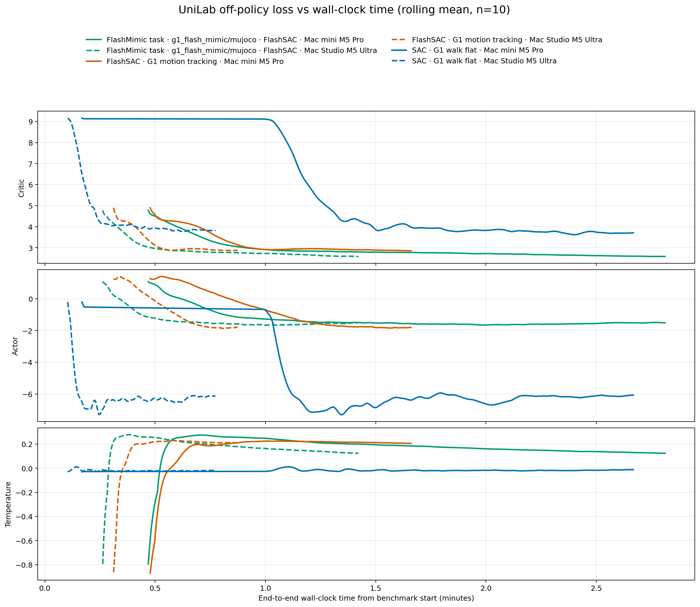

# UniLab Apple Silicon performance report

## Executive summary

This report covers six pinned UniLab-family MuJoCo training runs: three
experiment recipes on a Mac mini with Apple M5 Pro and on a Mac Studio that
`system_profiler` identifies as Apple M5 Ultra. All canonical runs completed
with Torch's Apple MPS backend available. The 500-iteration protocol measures a
bounded end-to-end performance window; it is not a convergence study. Across
matched recipes, the M5 Ultra Studio delivered **2.02–2.47× higher final
environment-step throughput** and reduced wrapper wall time by **46.1–69.9%**.

## Tested systems

| System | Model | CPU / GPU | Unified memory | OS | Power |
|---|---|---|---:|---|---|
| Mac mini | Mac17,16, M5 Pro | 18 CPU (12 Performance + 6 Super), 20 GPU | 64 GB | macOS 27.0.1 (26A434) | AC, high performance |
| Mac Studio | Mac17,15, M5 Ultra | 36 CPU, 80 GPU | 96 GB | macOS 27.0.1 (26A434) | AC |

Both systems are arm64, report Metal 4, use Apple Command Line Tools 27 / clang
21, and passed an actual Torch MPS allocation, matrix multiplication, backward,
synchronization, and finite-gradient check. The machine-readable inventories
are in `results/machines/`.

## Protocol and pins

Each recipe used seed 1, 2048 environments from its owner configuration, 500
iterations, per-iteration TensorBoard logging, and no post-training play. MuJoCo
simulation and manager tensors execute on CPU; the learner uses Apple MPS.

The exact immutable inputs are listed in [`config/versions.env`](config/versions.env)
and summarized in the README. SAC and FlashSAC use UniLab main commit
`d5aef9f740e081d835738979e9e4e852805b54c3`. FlashMimic uses commit
`e0a2b5c10f1b3815de0b830f5c035ae24e95171e` and its own frozen lock, selecting
the compatible UniLab 1.3.4 release. Both environments use unilab-rl 1.4.11,
unisim-core 1.7.15, Python 3.13.15, and MuJoCo 3.11.0.

The separate environment is necessary because current FlashMimic imports
`TensorMotionCommand`, which the latest UniLab main no longer exposes. No
upstream source was patched for this test.

Wall time for every plotted scalar is the TensorBoard event timestamp minus the
wrapper start recorded in `benchmark_start.json`. This includes process startup,
environment creation, replay warm-up, and compilation. G1 robot and motion
assets were materialized before canonical runs; an initial Studio FlashMimic
run that downloaded assets after the timer started was excluded and preserved
separately on the test host.

## Results

| Machine | Experiment | Status | Iterations | Environment steps | Training wall time (s) | End-to-end wall time (s) | Final throughput (steps/s) | Final mean reward |
|---|---|---:|---:|---:|---:|---:|---:|---:|
| Mac mini M5 Pro | SAC / G1 walk flat | completed | 500 | 1,044,480 | 150.86 | 163 | 10,306.73 | 15.6263 |
| Mac Studio M5 Ultra | SAC / G1 walk flat | completed | 500 | 1,044,480 | 40.88 | 49 | 25,433.45 | 15.9735 |
| Mac mini M5 Pro | FlashSAC / G1 motion tracking | completed | 500 | 1,224,704 | 71.96 | 102 | 14,338.46 | 1.0364 |
| Mac Studio M5 Ultra | FlashSAC / G1 motion tracking | completed | 500 | 1,224,704 | 34.51 | 55 | 30,628.15 | 0.9746 |
| Mac mini M5 Pro | FlashMimic task `g1_flash_mimic/mujoco` using FlashSAC | completed | 500 | 1,224,704 | 141.66 | 172 | 7,371.79 | 1.4907 |
| Mac Studio M5 Ultra | FlashMimic task `g1_flash_mimic/mujoco` using FlashSAC | completed | 500 | 1,224,704 | 70.40 | 88 | 14,860.87 | 1.6286 |

`Training wall time` is `run_summary.json.training_wall_time_sec`.
`End-to-end wall time` is the benchmark wrapper's integer-second interval from
before CLI process launch through successful process exit.

| Matched recipe | Studio / mini final throughput | Studio training-time reduction | Studio end-to-end reduction |
|---|---:|---:|---:|
| SAC / G1 walk flat | 2.47× | 72.9% | 69.9% |
| FlashSAC / G1 motion tracking | 2.14× | 52.0% | 46.1% |
| FlashMimic task `g1_flash_mimic/mujoco` using FlashSAC | 2.02× | 50.3% | 48.8% |

The requested loss figure contains critic, actor, and temperature loss panels.
Curves use a ten-event rolling mean for readability. The extracted unsmoothed
events are published in `results/processed/curves.csv`.

## Interpretation

The performance comparison should use wall time, environment-step throughput,
and within-recipe curve progression. Loss magnitude itself is not comparable
across SAC, FlashSAC, and the FlashMimic task: their objectives,
observation/action handling, and networks differ. FlashMimic is a G1
whole-body motion-imitation task package whose learner is FlashSAC, rather than
a third standalone learner algorithm. The canonical task owner is
`g1_flash_mimic/mujoco`; its configuration points to the packaged motion file
`dance1_subject2_part.npz`.

Within each matched recipe, the two machines reached similar loss scales after
the same iteration/step budget while the Studio completed sooner. The final
critic loss was 3.716/3.834 (mini/Studio) for SAC, 2.859/2.873 for FlashSAC,
and 2.578/2.570 for the FlashMimic task. These close endpoints are an execution
consistency check, not proof that the learned policies are equivalent.

SAC shows the largest end-to-end gap: the Studio shortened the 500-iteration
wrapper interval from 163 s to 49 s. Its final steady-state throughput advantage
(2.47×) is smaller than the bounded-window training-time advantage (3.69×),
which shows that startup/compilation overhead is material at this short budget.
FlashSAC and the FlashMimic task show approximately twofold throughput and
training-time differences.

Five hundred iterations are sufficient to compare startup and steady-state
execution under a fixed recipe, but not to establish final policy quality or
convergence. Reward is included as contextual evidence only.

## Observed warnings and limitations

- FlashMimic's upstream documentation formally targets Linux/NVIDIA. This is an
  Apple MPS evaluation and must not be represented as an upstream support claim.
- Motion reset emitted a Torch recompilation warning on the tested MPS path.
- CUDA graphs are skipped on Apple MPS, as expected.
- A non-writable NumPy array warning and a FlashMimic initial applied-torque
  host-view warning were observed. Neither stopped the completed runs.
- The machines used the same frozen dependency graphs but preinstalled uv patch
  releases differed; uv only performed environment synchronization and was not
  in the timed training process.
- Only one seed and one bounded run per experiment-machine pair were requested;
  no confidence interval or run-to-run variance can be reported.

## Audit trail

Every canonical directory contains the TensorBoard event file,
`run_config.json`, `run_summary.json`, the benchmark wrapper's start/end JSON,
and the complete console log. Checkpoints and video are omitted to keep the
submission repository reviewable. Reproduction commands and collection details
are in [`README.md`](README.md).
