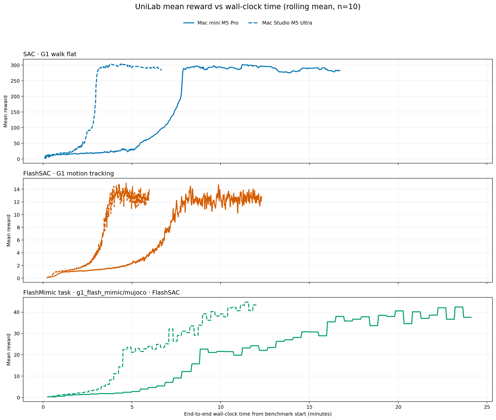

# UniLab Apple Silicon performance report

The figure and two tables below are generated from the validated TensorBoard and run metadata artifacts. This checked-in snapshot was validated with the explicit uniform `--expected-iterations 5000` override.

| Machine | Experiment | Status | Iterations | Environment steps | Training wall time (s) | End-to-end wall time (s) | Tail-half throughput (steps/s) | Final mean reward | Final video |
|---|---|---:|---:|---:|---:|---:|---:|---:|---|
| Mac mini M5 Pro | SAC · G1 walk flat | completed | 5,000 | 10,260,480 | 998.11 | 1,006 | 10,314.05 | 282.7983 | not collected |
| Mac Studio M5 Ultra | SAC · G1 walk flat | completed | 5,000 | 10,260,480 | 395.50 | 402 | 26,158.03 | 283.5175 | not collected |
| Mac mini M5 Pro | FlashSAC · G1 motion tracking | completed | 5,000 | 10,440,704 | 725.35 | 741 | 13,986.90 | 12.4588 | not collected |
| Mac Studio M5 Ultra | FlashSAC · G1 motion tracking | completed | 5,000 | 10,440,704 | 344.06 | 362 | 29,752.11 | 13.8394 | not collected |
| Mac mini M5 Pro | FlashMimic task · g1_flash_mimic/mujoco · FlashSAC | completed | 5,000 | 10,440,704 | 1,432.23 | 1,449 | 7,128.40 | 40.1184 | not collected |
| Mac Studio M5 Ultra | FlashMimic task · g1_flash_mimic/mujoco · FlashSAC | completed | 5,000 | 10,440,704 | 709.53 | 725 | 14,453.95 | 39.8086 | not collected |

| Matched recipe | Studio / mini tail-half throughput | Studio training-time reduction | Studio end-to-end reduction |
|---|---:|---:|---:|
| SAC · G1 walk flat | 2.54× | 60.4% | 60.0% |
| FlashSAC · G1 motion tracking | 2.13× | 52.6% | 51.1% |
| FlashMimic task · g1_flash_mimic/mujoco · FlashSAC | 2.03× | 50.5% | 50.0% |

Throughput is the time-weighted environment-step rate over the latter half of each run. Reward curves use a 10-event rolling mean; the CSV retains raw values. FlashMimic is the `g1_flash_mimic/mujoco` task package using the FlashSAC learner. Training timing excludes final policy playback; each MP4 is rendered after training from that run's final checkpoint.
